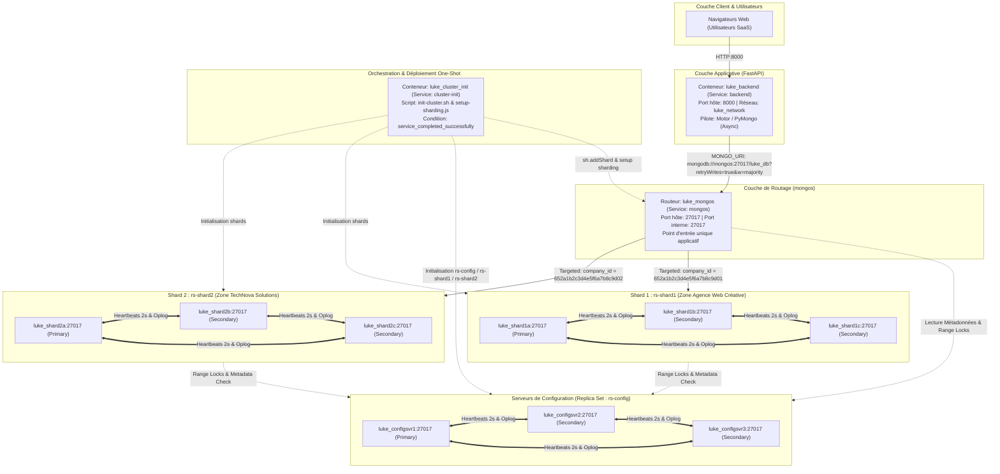
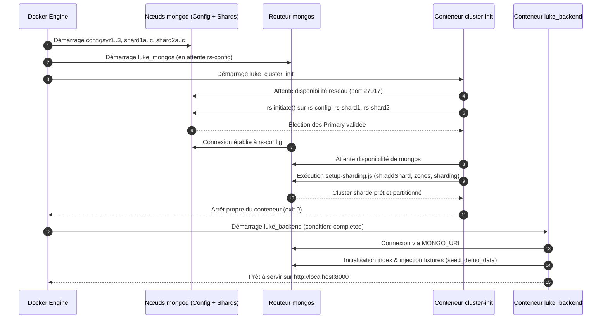

# Spécification Technique – Architecture Distribuée MongoDB (Partie II)

**Projet SaaS Luke** – BUT3 Informatique  
**Auteurs** : Lukas Toulelle & Julie Le Callennec  

---

## 1. Contexte & Objectifs de la Scaleup

Dans le cadre du passage de notre startup en scaleup, l'architecture technique de **Luke** évolue pour répondre à deux problématiques fondamentales :
1. **La Haute Disponibilité (High Availability - HA)** : Assurer la continuité de service sans interruption même en cas de panne matérielle ou réseau d'un serveur de données, grâce à l'élection automatique d'un nouveau nœud primaire.
2. **La Montée en Charge Horizontale (Sharding)** : Répartir le stockage et la charge des requêtes sur plusieurs serveurs de données (Shards) afin d'accueillir un nombre croissant d'entreprises clientes (Tenants) et de collaborateurs sans saturation des ressources.

Cette évolution s'opère sans modifier les fonctionnalités applicatives développées en Partie I (API REST FastAPI, tableau Kanban interactif, filtres avancés, isolation multi-tenant stricte). L'interface utilisateur repose sur une architecture web réactive en requêtes HTTP asynchrones (AJAX/Fetch) avec rafraîchissement d'état unifié.

---

## 2. Architecture Globale des Serveurs & Flux Réseaux

Le cluster distribué complet est orchestré via Docker Compose et comprend **12 conteneurs Docker au total** interconnectés sur un réseau bridge dédié (`luke_network`) :
* **10 conteneurs MongoDB résidents** : 3 Config Servers + 3 nœuds Shard 1 + 3 nœuds Shard 2 + 1 routeur `mongos`.
* **1 conteneur d'orchestration one-shot** : `luke_cluster_init` qui initialise les Replica Sets, configure le Sharding et les zones, puis s'arrête (`exit 0`).
* **1 conteneur applicatif web** : `luke_backend` (FastAPI / Uvicorn).

### 2.1. Schéma d'Architecture & Flux Réseaux



### 2.2. Tableau Détaillé des Composants et Ports Réseau

| Rôle dans l'Architecture | Service Compose | Nom Conteneur | Port Interne (`luke_network`) | Port Exposé (Hôte) | Volume Persistant |
|---|---|---|---|---|---|
| **Routeur de requêtes** | `mongos` | `luke_mongos` | `27017/tcp` | `27017:27017` | Aucun (stateless) |
| **Config Server 1** | `configsvr1` | `luke_configsvr1` | `27017/tcp` | Non exposé | `cfg1_data:/data/db` |
| **Config Server 2** | `configsvr2` | `luke_configsvr2` | `27017/tcp` | Non exposé | `cfg2_data:/data/db` |
| **Config Server 3** | `configsvr3` | `luke_configsvr3` | `27017/tcp` | Non exposé | `cfg3_data:/data/db` |
| **Shard 1 - Nœud A** | `shard1a` | `luke_shard1a` | `27017/tcp` | Non exposé | `shard1a_data:/data/db` |
| **Shard 1 - Nœud B** | `shard1b` | `luke_shard1b` | `27017/tcp` | Non exposé | `shard1b_data:/data/db` |
| **Shard 1 - Nœud C** | `shard1c` | `luke_shard1c` | `27017/tcp` | Non exposé | `shard1c_data:/data/db` |
| **Shard 2 - Nœud A** | `shard2a` | `luke_shard2a` | `27017/tcp` | Non exposé | `shard2a_data:/data/db` |
| **Shard 2 - Nœud B** | `shard2b` | `luke_shard2b` | `27017/tcp` | Non exposé | `shard2b_data:/data/db` |
| **Shard 2 - Nœud C** | `shard2c` | `luke_shard2c` | `27017/tcp` | Non exposé | `shard2c_data:/data/db` |
| **Orchestrateur Cluster** | `cluster-init` | `luke_cluster_init` | - | Non exposé | `./scripts/cluster-init` (ro) |
| **Application Web SaaS** | `backend` | `luke_backend` | `8000/tcp` | `8000:8000` | Aucun (image build) |

> [!NOTE]
> **Remarque d'ingénierie sur le routeur mongos unique (SPOF assumé)** :  
> Dans le cadre académique et pédagogique de ce projet, un seul conteneur `mongos` est instancié afin de limiter l'empreinte mémoire RAM de la stack sur une machine locale de développement (12 conteneurs consommant déjà ~1,5 Go de mémoire).  
> En environnement de production à grande échelle, la redondance est immédiate : il suffit de déployer au moins deux instances de `mongos` (ex. `mongos1`, `mongos2`) derrière un répartiteur de charge (HAProxy, Envoy ou DNS round-robin), et de configurer la chaîne de connexion avec les deux hôtes : `mongodb://mongos1:27017,mongos2:27017/luke_db?retryWrites=true&w=majority`, sans aucune modification du code applicatif.

---

## 3. Justification des Clés de Sharding & Gestion des Contraintes d'Unicité

Le partitionnement d'une base de données multi-tenant requiert une modélisation rigoureuse pour concilier la co-localisation des données, l'élimination des requêtes dispersées (*Scatter-Gather*), la prévention des *jumbo chunks* et le respect des règles d'intégrité de MongoDB.

### 3.1. Règles Fondamentales de MongoDB sur le Sharding et l'Unicité

En MongoDB shardé, une contrainte d'unicité ne peut être garantie de façon distribuée que si le moteur peut s'assurer qu'aucun doublon n'existe sur un autre shard. Par conséquent, **la Shard Key doit obligatoirement être un préfixe de tout index unique**.

### 3.2. Clés Retenues par Collection

| Collection | Clé de Sharding | Type | Index Unique Associé | Justification & Rôle du Second Champ |
|---|---|---|---|---|
| **`tasks`** | `{ company_id: 1, _id: 1 }` | Ranged Composée | Aucun | Co-localisation par tenant. Le second champ `_id: 1` augmente la cardinalité et évite les *jumbo chunks* (>64 Mo). |
| **`projects`** | `{ company_id: 1, _id: 1 }` | Ranged Composée | Aucun | Co-localisation par tenant. Permet de subdiviser les chunks si une entreprise possède un historique projet volumineux. |
| **`users`** | `{ company_id: 1, email: 1 }` | Ranged Composée | `{ company_id: 1, email: 1 }` (unique) | La Shard Key est identique à l'index unique : MongoDB garantit l'unicité de l'email par entreprise au niveau moteur tout en ciblant le shard du client. |
| **`companies`** | `{ _id: "hashed" }` | Hashed | Aucun (slug unique applicatif) | Répartition uniforme des entreprises clientes sur l'ensemble des shards sans créer de point chaud. |

#### A. Rôle du second champ `_id: 1` sur `tasks` et `projects` (Prévention des Jumbo Chunks)
Si la Shard Key était uniquement `{ company_id: 1 }`, toutes les tâches d'une entreprise posséderaient rigoureusement la même valeur de clé de sharding. Si un client actif dépasse la taille maximale d'un chunk (64 Mo par défaut dans MongoDB), MongoDB se retrouverait dans l'impossibilité physique de scinder le chunk (*Jumbo Chunk indivisible*).  
En ajoutant `_id: 1` comme second membre, la cardinalité devient quasi infinie : le cluster est capable de découper les chunks d'une même entreprise en plusieurs sous-plages ordonnées sur l'`ObjectId` sans jamais bloquer l'équilibrage.

#### B. Gestion de l'unicité de `companies.slug`
Comme `companies` utilise un hachage sur `_id` pour disperser les workspaces, MongoDB interdit la pose d'un index unique distribué sur un champ non préfixé par la Shard Key (tel que `slug`).  
* **Solution d'architecture** : L'index standard `{ slug: 1 }` est maintenu pour accélérer les recherches, et l'unicité du slug est validée au niveau applicatif par FastAPI dans `app/routers/companies.py` (vérification `find_one({"slug": slug})` levant une erreur HTTP 409 `Conflict` en cas de doublon).

### 3.3. Mécanisme de Répartition : Zone Sharding & Pre-splitting

Un partitionnement par plage (*Ranged*) sur des identifiants `ObjectId` générés de manière séquentielle risquerait de concentrer toutes les écritures sur le shard contenant la plage la plus élevée (*monotonically increasing hotspot*).

Pour éliminer ce risque et démontrer une répartition 100 % déterministe entre les shards, `setup-sharding.js` met en œuvre le **Zone Sharding** officiel de MongoDB :
1. **Création des Zones sur les Shards** :
   * `sh.addShardToZone("rs-shard1", "ZONE_AGENCE_WEB")`
   * `sh.addShardToZone("rs-shard2", "ZONE_TECHNOVA")`
2. **Assignation des plages de clés par entreprise** :
   * Pour l'*Agence Web Créative* (`company_id` = `ObjectId("652a1b2c3d4e5f6a7b8c9d01")`) :  
     La plage de `MinKey` à `MaxKey` sur ce `company_id` est affectée à `ZONE_AGENCE_WEB` (`rs-shard1`).
   * Pour *TechNova Solutions* (`company_id` = `ObjectId("652a1b2c3d4e5f6a7b8c9d02")`) :  
     La plage de `MinKey` à `MaxKey` sur ce `company_id` est affectée à `ZONE_TECHNOVA` (`rs-shard2`).
3. **Pre-splitting & MoveChunk immédiats** :  
   Des commandes `sh.splitAt()` et `sh.moveChunk()` sont exécutées à l'initialisation afin de positionner immédiatement les chunks de TechNova sur `rs-shard2` sans attendre le passage périodique du balancer d'arrière-plan.

---

## 4. Haute Disponibilité & Tolérance aux Pannes (Failover)

### 4.1. Protocole d'Élection et Quorum (Règle N/2 + 1)
Chaque Replica Set (`rs-config`, `rs-shard1`, `rs-shard2`) comporte **3 nœuds votants** :
* 1 nœud **Primary** (reçoit les opérations d'écriture et lectures principales).
* 2 nœuds **Secondary** (répliquent l'Oplog et votent en cas d'élection).

Le quorum strict de $2/3$ garantit une protection absolue contre le syndrome du *Split-Brain*.

### 4.2. Chronologie d'un Basculement Automatique (Failover)
En cas d'arrêt brutal ou de crash matériel du nœud Primary :
1. **Détection de la perte** : Les deux nœuds Secondaries envoient des paquets de contrôle (*Heartbeats*) toutes les **2 secondes**. En l'absence de réponse au-delà du délai d'élection configuré (`electionTimeoutMillis`, par défaut **10 secondes**), le nœud Primary est déclaré inaccessible.
2. **Phase d'Élection** : Le Secondary le plus en avance dans la réplication de l'Oplog se déclare candidat et sollicite le vote de ses pairs. Avec 2 votes favorables sur 3, le quorum est atteint et le candidat est promu **Primary**.
3. **Fenêtre de Bascule (~10 à 12 secondes)** :  
   Pendant ce bref intervalle d'élection, aucune écriture ne peut être validée sur ce shard.  
   Grâce au pilote asynchrone Motor/PyMongo configuré avec `retryWrites=true&w=majority`, le backend FastAPI ne lève aucune exception : il met automatiquement la requête en attente (*retry buffering*) et la rejoue avec succès dès l'établissement du nouveau Primary.  
   **Côté utilisateur sur le Kanban, l'action réussit avec un code HTTP 200 OK sans aucune intervention manuelle.**
4. **Réintégration post-panne** :  
   Lorsque le conteneur arrêté est redémarré (`docker start luke_shard1a`), il se reconnecte au cluster, constate qu'un terme d'élection supérieur a été acté, adopte le rôle de **Secondary** et resynchronise les écritures manquées depuis l'Oplog.

---

## 5. Déploiement et Séquence d'Orchestration

L'ensemble de l'infrastructure démarre à l'aide d'une seule et unique commande exécutée à la racine du projet :

```bash
docker compose up -d --build
```

### Séquence d'Exécution Automatisée :



1. **Démarrage des services MongoDB** : Les 3 serveurs de configuration et les 6 nœuds de shards démarrent en parallèle sur `luke_network`.
2. **Démarrage de `mongos`** : Le routeur démarre et tente de se lier au Replica Set `rs-config`.
3. **Exécution de `cluster-init`** : Le script [init-cluster.sh](file:///c:/Users/luj/Desktop/Projet-SAAS/Luke/scripts/cluster-init/init-cluster.sh) attend que chaque nœud réponde au ping, initialise les Replica Sets `rs-config`, `rs-shard1` et `rs-shard2`, attend que `mongos` soit opérationnel, puis exécute [setup-sharding.js](file:///c:/Users/luj/Desktop/Projet-SAAS/Luke/scripts/cluster-init/setup-sharding.js).
4. **Configuration du Sharding** : Rattachement des shards, activation de `luke_db`, sharding des 4 collections et configuration des zones multi-tenant.
5. **Sortie propre** : `cluster-init` termine sa mission et sort avec le code `0`.
6. **Lancement de `luke_backend`** : Grâce à la directive Docker Compose `depends_on: { cluster-init: { condition: service_completed_successfully } }`, le backend démarre uniquement lorsque l'infrastructure de stockage est prête.
7. **Initialisation applicative** : Le backend vérifie la connexion, adapte les index et injecte automatiquement les fixtures de démonstration. L'interface utilisateur est accessible sur `http://localhost:8000`.
